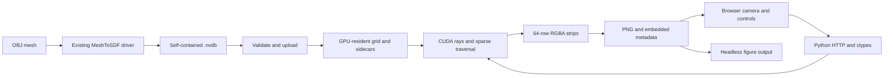

# Implementation and data contracts

This directory is a self-contained application. The parent CMake build is not
changed. The renderer reads NanoVDB headers but does not modify the producer,
input grids, topology, stored signs, or distance values.

## Source map

| File | Responsibility |
|---|---|
| `CMakeLists.txt` | Shared CUDA renderer; optional existing mesh converter and CPU test-fixture generator |
| `renderer.h` | Plain C-compatible settings/metadata structs and exported entry points |
| `renderer.cu` | Host loading/validation, device ownership, channel binding, kernel launch and error reporting |
| `field.cuh` | Float SDF lookup or ValueOnIndex sidecar lookup with inactive-interior sign recovery |
| `render.cuh` | Camera rays, HDDA traversal, voxel cubes, surfaces, volume integration, slices and color encoding |
| `viewer.py` | ctypes binding, input checks, local HTTP server, tiled PNG writer, CLI/headless rendering |
| `index.html` | Self-contained browser UI, camera interaction, preview scheduling and downloads |
| `make_test_grids.cpp` | Analytic sphere, equivalent index sphere and sign-mask fixtures |
| `test_viewer.py` | GPU/image/file-contract regression tests without Python dependencies |

## File and field interpretation

Supported input is either a `Float` grid tagged `LevelSet` or this branch's
`ValueOnIndex` MeshToSDF output. Quantized, double, ValueIndex, fog, UDF-only and
other custom grids are deliberately rejected rather than guessed.

A ValueOnIndex value is a **uint64 array offset**, not a floating-point distance.
For active voxels `field.getValue(ijk)` returns `sdf[index]`. Index zero is the
positive narrow-band background slot. Inactive interior queries need the masks:

| Channel | Element type and size | Meaning |
|---|---|---|
| `sdf` | float × grid valueCount | World-unit signed distances, including positive background slot 0 |
| `leaf_invert` | uint64 × leafCount × 8 | 512 sign bits for each 8³ leaf; only inactive bits are used by this accessor |
| `lower_invert` | uint64 × lowerCount × 64 | Sign of childless lower-node entries (8³ voxel tiles) |
| `upper_invert` | uint64 × upperCount × 512 | Sign of childless upper-node entries (128³ voxel tiles) |
| `root_interior` (list format) | int32 × 3 × tileCount | Origins in voxel coordinates of negative 4096³ root regions |
| `root_interior` (dense format) | uint8 × nx × ny × nz | Nonzero means negative, with coordinates described by `root_extent` |
| `root_extent` (dense format) | int32 × 6 | `[minTileX,minTileY,minTileZ,nx,ny,nz]`, in root-tile coordinates |

The type of `root_interior` selects its decoder. List-format root origins are
aligned multiples of 4096. Dense lookup uses
`q = (ijk >> 12) - minTile`, then `(q.x * ny + q.y) * nz + q.z` after bounds checks.
An absent optional root channel means no negative root regions. A dense mask with
missing/invalid extent is an error. This supports both the committed producer
and the newer working-tree producer used during the original hairball tests.

When a voxel is inactive, lookup checks the cached leaf/lower/upper node whose
origin actually contains the coordinate, then its corresponding mask. Cached
pointers can survive a cache miss, so a non-null pointer alone is insufficient.
Absent root regions use the root decoder. The resulting value is ±background;
its sign is meaningful, but its magnitude is truncated, not an exact deep distance.

The producer's topology must be breadth-first/sequential because mask indices
are obtained from node offsets relative to the first node of the same level.
The loader validates channel names/types/counts and buffer bounds, positive finite
background, nonempty active bounds and uniform unsheared voxel transforms.
It is intended for locally generated files; it is not a complete hostile-file
validator for every NanoVDB structural invariant.

## Six rendering modes

`RenderSettings.mode` is stable across C++/Python/JSON:

| ID | UI | Geometry / field queried |
|---:|---|---|
| 0 | SDF surface | Trilinear SDF iso crossing |
| 1 | Transmittance volume | Continuous shell density around the trilinear SDF iso value |
| 2 | Surface normals | Same crossing as mode 0, world gradient encoded as RGB |
| 3 | Sign slice · full field | Nearest voxel on plane, including inactive interior/exterior |
| 4 | Signed active voxels | Exact active unit-cube topology, sign-colored faces |
| 5 | Sign slice · active band | Nearest active voxel on plane; inactive samples are transparent |

### Active voxel cubes (mode 4)

An active voxel at integer `ijk` represents the cube
`[ijk - 0.5, ijk + 0.5]` in index space. The ray is shifted by +0.5 for HDDA so its
integer cell boundaries match these cubes. Traversal uses tree dimensions through
empty nodes and dimension 1 inside leaves, checks the actual `isActive` mask,
and returns the **first active cube intersection**. No iso threshold, interpolation,
SDF distance march, or surface reconstruction is used in this mode.

The stored sign determines orange/blue color; flat face lighting and thin dark
cell edges make the voxel boundaries readable. Inactive interior tiles are not
rendered. Cubes are opaque: positive exterior voxels naturally hide the negative
inner band from an outside camera. Clipping removes the near part of the grid and
reveals both sides of the band. This is still the entire active topology, even
though only its first visible face per ray contributes to an opaque image.
There is no large instance buffer or polygon mesh proportional to voxel count.

### Surface crossing (modes 0 and 2)

World camera rays are transformed to index space. Leaf-level HDDA uses larger
steps through absent nodes; within leaf intervals the shader samples the
trilinearly interpolated SDF at a bounded `step` (index/voxel units). A sign change
relative to `iso * voxelSize` brackets a hit, refined with nine bisection steps.
Exact zero samples also count as hits. A 1.75-voxel traversal halo covers the
trilinear support across leaf boundaries, and overlapping ray intervals are
processed only once.

This is an iso/zero-crossing renderer, but does not call the stock
`math::zeroCrossing` or `math::isoCrossing` helpers directly. Those helpers' normal
channel access alone does not account for the custom inactive-interior masks.
The implementation reuses NanoVDB HDDA and adds the signed accessor and refinement.
Sub-step tangencies or very thin features can be missed; it is not an analytic
solver for every root of a trilinear cell. Decrease the ray step and increase
pixel samples to check visual convergence.

Normals use central differences over ±0.5 index units and inverse-transpose
mapping to world space. Surface shading combines a view-relative light,
diffuse/specular terms, a rim term and optional local SDF occlusion. Normal-view
RGB shows the outward gradient before two-sided shading flips. It is not a
mesh normal, global illumination or an unbiased path-tracing estimator.

### Volume integration (mode 1)

For voxel size `dx`, let `d = abs(sdf - iso*dx)/dx`. The shell density is
`rho = max(0, 1 - d/shell)`. A ray segment of index-space length `ds` contributes
`alpha = 1 - exp(-density * rho * ds)`. Front-to-back premultiplied color and
opacity accumulate until traversal ends or alpha exceeds 0.9995.

Shading is gradient/view dependent; there is no scattering transport or density
calibration to a physical material. Compact support and the strict constraint
`abs(iso)+shell < background/dx` keep truncated background from turning into fog.
The opacity is a chosen visualization of distance, **not the grid's active mask**.
Changing shell thickness cannot be used to count active band layers.

### Sign slices (modes 3 and 5)

The ray intersects an index-axis-aligned plane at `clipPosition`. Lookup uses
`floor(p + 0.5)` and the stored sign bit, so negative zero is colored negative.
Mode 3 includes inactive regions and brightens near-zero values using
`exp(-abs(sdf)/dx)`. That bright stripe has roughly one-voxel scale and must not be
interpreted as the width of the active narrow band. Mode 5 filters by the actual
active mask and uses uniform sign colors, exposing the full positive/negative band.
Multiple pixel samples may average adjacent voxel colors even though each query
is nearest-neighbor; use 1 spp and sufficient zoom for discrete inspection.

## Camera, units, image pipeline

Eye, target and up are world-space vectors. `clipAxis` and `clipPosition` refer to
index space and keep coordinates <= the plane. `iso`, `shell` and `step` are in
voxel units; SDF channel values and orthographic scale are in world units. The
camera axis buttons look along world axes, which need not match index axes for
rotated transforms. Only uniform scaling (with translation/rotation) is supported.

For supersampling, a deterministic base-2/base-3 sequence supplies pixel offsets.
It depends on sample index, not tile position, so rendering strips or subrectangles
matches the full frame. RGB is accumulated in linear light. Transparent output is
unpremultiplied after accumulation; opaque output composites with the background.
Exposure multiplies linear RGB by `2^exposure`; values are clamped and encoded to
8-bit sRGB. HDR values beyond that range are not retained.

`Renderer.png()` requests full-width 64-row strips and streams zlib-compressed PNG
chunks. Width/height <= 16384 and <= 100 MP are accepted by Python. Device image
storage is at most 4 MiB at maximum strip width. Metadata includes 300 dpi, sRGB,
settings, dimensions, samples, source path and grid dimensions/counts. It does not
contain the full input grid or a content hash. CLI output uses a temporary file
followed by rename so failures cannot replace a completed image with a partial PNG.

## Runtime and API boundaries

`sdf_open` loads one selected grid to host memory, validates/binds its channels,
uploads it once, and releases the host handle. The context owns the device grid,
reusable pixel storage and a traversal-error flag. It reports insufficient VRAM
before allocating the grid, leaving a 64 MiB margin. There is no grid streaming.

`sdf_render` accepts a full-frame extent plus a tile rectangle and writes RGBA8
into caller-provided host storage. `sdf_probe` queries raw integer voxel coordinates.
`sdf_error` exposes a thread-local error string; C++ exceptions never cross the C
boundary. `sdf_close` releases the context. All these declarations and ctypes
struct layouts must be changed together when extending the ABI.

Python serializes GPU use with a lock because context output buffers are reused.
The threaded HTTP server serves `/`, `/info`, `/render`, and `/export`. Rendering
finishes into a spool file before sending HTTP 200 so errors are returned to the
UI. The browser maintains one in-flight preview and a latest pending request;
outdated frames are discarded. GPU work already submitted is not cancellable.
The service binds to 127.0.0.1, uses same-origin POSTs and has no cloud dependency.

Two-million-iteration guards fail a frame if ray traversal stops making progress
or is excessive. Nonpositive steps, invalid cameras, unsupported data and invalid
band parameters report explicit errors rather than silently publishing partial
figures. These guards do not imply formal validation of the SDF itself.

## Tests and debugging

`test_viewer.py` generates independent float/index sphere references and small
mask fixtures. It checks analytic silhouettes, equal float/index output in all
six modes, both root formats, all mask levels, invalid metadata, negative
coordinates, clip planes, inside-camera rays, active-band colors, tiled output
identity, PNG CRCs/metadata and atomic failure handling.

The existing MeshToSDF producer is intentionally not the reference for these
renderer tests. For a suspected producer bug, compare a sign slice or probe
against analytic/independent truth and save the `.nvdb` plus camera JSON. A
beautiful isosurface alone is not a sign-validation test. The optional converter
can be built and exercised separately without editing parent library files.
