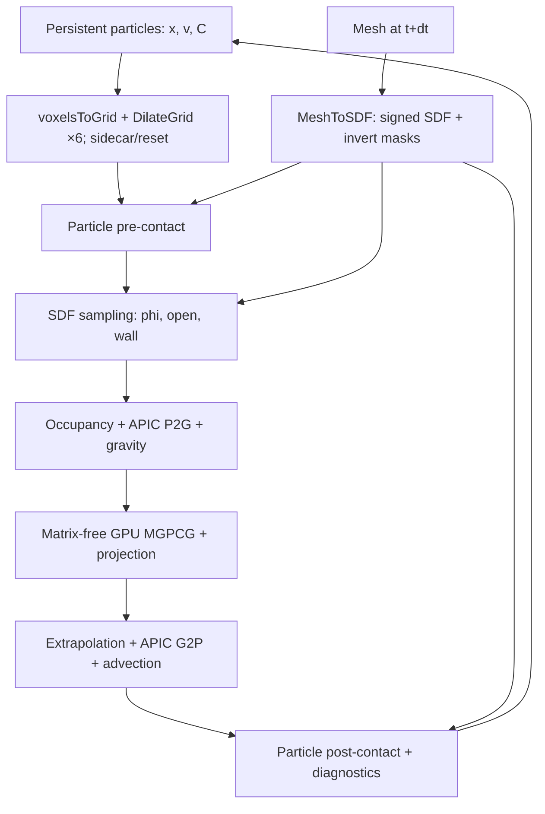

# NanoVDB GPU APIC 액체 solver — 현재 구현 사양

기준: 2026-10-06, `mesh-to-sdf-fluid` 브랜치의 현재 작업 트리.
이 문서는 기본 3단계 데모와 공통 solver를 중심으로 설명한다. 캐릭터 animation,
연속 emitter, foam/spray, anisotropic surface와 restart는 `scene/` 확장에 구현돼 있으며
[SCENE_IMPLEMENTATION.md](SCENE_IMPLEMENTATION.md)에 별도로 기술한다. 최신 캐릭터
확장성 변경(float/double, GPU 입자 관리, Cell 축소, MGPCG)은
[SCALABILITY.md](SCALABILITY.md)에 상세히 설명한다. 장면의 원인 분석과 결과는 [STREAM_REFINEMENT_RESULTS.md](STREAM_REFINEMENT_RESULTS.md)에 있다.
기본 데모의 실행·측정 결과는
[HIGHER_RESOLUTION_RESULTS.md](HIGHER_RESOLUTION_RESULTS.md), 기존 해상도 결과는
[LONG_RUN_RESULTS.md](LONG_RUN_RESULTS.md)를 참조한다.

## 1. 구현 개요

입자의 위치·속도·affine 행렬을 지속 상태로 보존하고, NanoVDB `ValueOnIndex` grid를
좌표 → GPU sidecar index 조회에 사용한다. 각 sidecar에는 cell 중심의 fluid 분류와
MAC face의 질량 가중치·속도·고체 경계 정보를 함께 저장한다.

APIC 전송, 외력, pressure projection, velocity extrapolation, 입자 이동·접촉은
이 예제의 CUDA kernel로 구현했다. Pressure는 **matrix-free GPU MGPCG**로 푼다.
입자/셀/vector의 float 또는 double을 선택하고 CG 내적은 double로 누적한다.
Cooperative kernel이 반복과 수렴을 제어한다. 전체 timestep의 host orchestration은 남는다.

| 구분 | 현재 구현 |
|---|---|
| Fluid grid | `NanoGrid<ValueOnIndex>`, 별도 `Cell[]` GPU sidecar |
| Persistent fluid state | `Particle[]`: 위치 `x`, 속도 `v`, 3×3 APIC 행렬 `C` |
| Transfer | Quadratic B-spline APIC, MAC component마다 3×3×3 stencil |
| Fluid/air | 입자가 들어 있는 cell의 occupancy mask |
| Pressure | 6-face weighted Laplacian, matrix-free MGPCG (Jacobi 대조 옵션) |
| Obstacle | 기존 `MeshToSDF` 출력의 signed sidecar와 invert mask |
| Topology | 고정 영역 또는 매 substep 입자 좌표에서 재생성 + dilation 6회 |
| Visualization | CSV → USD particle marker/mesh → 기존 ovrtx → PNG/MP4 |

기본 실행파일의 검증 장면은 dam break와 정지·이동·변형 cuboid다. 캐릭터 animation 입력과
고정 연결 구조의 mesh 시퀀스 로더는 `scene/` 확장에 구현돼 있다. Solver와 변환·검증 코드는 모두
이 예제 폴더에 있으며, 기존 라이브러리와 ovrtx 코드에 이번 작업의 수정은 없다.

## 2. 코드 위치

| 파일 | 역할 및 주요 진입점 |
|---|---|
| [Fluid.cuh](Fluid.cuh) | `Particle`, `Cell`, `Domain`, `Solver`; APIC, pressure, topology, extrapolation |
| [Obstacle.cuh](Obstacle.cuh) | `Motion`, `Obstacle::build`, `ObstacleView::sdf`; face 경계, 접촉, 독립 진단 |
| [Run.cuh](Run.cuh) | 시간·출력 스케줄, `scene.json`, 에너지·CFL·tank 진단 |
| [Validation.cuh](Validation.cuh) | `transferTest`: constant/affine APIC roundtrip |
| [main.cu](main.cu) | 5개 실행 mode와 substep 순서 |
| [validate.py](validate.py), [validate_long.py](validate_long.py) | 짧은 회귀 실행 및 물리 시간 기준 장기 검증 |
| [render.py](render.py), [animate.py](animate.py) | USD 작성, ovrtx 재생, particle/block debug 영상 |
| [assemble_animation.py](assemble_animation.py) | montage, GIF, 대표 프레임, MP4 decode 검사 |
| [report_long.py](report_long.py), [compare_resolution.py](compare_resolution.py) | 측정 보고서와 해상도 비교 |
| [scene_config.py](scene_config.py) | 검증·렌더가 공유하는 해상도 메타데이터 |
| [../CMakeLists.txt](../CMakeLists.txt) | `ex_mesh_to_sdf_fluid_cuda` target 등록 |

## 3. NanoVDB operator 사용 내역

### 3.1 예제에서 직접 호출하는 operator

| API | 사용 위치 | 실제 용도 |
|---|---|---|
| [`voxelsToGrid<ValueOnIndex>`](../../tools/cuda/PointsToGrid.cuh) | `Solver::rebuild` | GPU의 정수 `Coord[]`로 index topology 생성 |
| [`DilateGrid<ValueOnIndex>`](../../tools/cuda/DilateGrid.cuh) | 동적 `Solver::rebuild` | 기본 26-neighbor dilation 6회로 필요한 활성 voxel/halo 확보 |
| [`MeshToSDF<ValueOnIndex>`](../../tools/cuda/MeshToSDF.cuh) | `Obstacle::build` | 현재 substep의 mesh에서 별도 obstacle SDF index grid 생성 |

호출 형태는 다음과 같다. `coords`는 world-space point가 아니라 이미
`floor(particle.x / h)`로 계산한 **index-space cell 좌표**다.

```cpp
topology = nanovdb::tools::cuda::voxelsToGrid<Build>(coords.data(), particleCount, d.h);
for (int k = 0; k < 6; ++k) {
    nanovdb::tools::cuda::DilateGrid<Build> dilate(topology.deviceGrid<Build>());
    topology = dilate.getHandle();
}

Converter converter(vertices.data(), 8, triangles.data(), 12, map);
converter.setNarrowBandWidth(float(view.band / view.h));
converter.setBarrierSigning(Converter::BarrierSigning::Heuristic);
handle = converter.getHandle();
```

`PointsToGrid.cuh`의 `voxelsToGrid` 경로를 사용한다. World-space points를 blind data에
저장하는 `pointsToGrid` 호출로 APIC 질량·속도를 rasterize하는 구현은 아니다.
`nanovdb::cuda::Buffer`, `GridHandle<DualDeviceBuffer>`, `DeviceGridTraits`도 재사용한다.

### 3.2 내부 사용과 검토한 API

기존 `MeshToSDF` 내부에는 `MeshToGrid`, `ConnectedComponents`, `PruneGrid`,
기존 `PropagateSign`, `addBlindData` 경로가 있다. 이는 obstacle 변환기의 내부 호출이다.
실험용 `MeshToSDF_NEW`와 `PropagateSign_BitJacobi`/`PropagateSign_BitScanline`은 사용하지 않는다.

Fluid topology 갱신에서는 `PruneGrid`를 별도로 호출하지 않는다. 이 API는 leaf별
`Mask<3>[]`로 남길 voxel을 지정하는 operator다. 현재 구현은 매번 입자에서 새 grid를
만들므로, 필요 없어진 voxel은 이전 grid와 함께 제거된다.

`MergeGrids`도 직접 사용하지 않는다. 이 operator는 active topology의 union을 만든다.
월드 위치가 일치하려면 입력 transform도 맞아야 하며, 물리적 sidecar 채널의 합성이나
고체 경계 조건 처리를 대신하지 않는다. Fluid와 obstacle은 서로 다른 voxel size를
사용하고 world-space SDF sampling으로 연결한다.

## 4. 좌표, MAC 배치, sidecar

`Build = nanovdb::ValueOnIndex`, `Grid = nanovdb::NanoGrid<Build>`다.
Grid voxel 값은 물리량이 아니라 sidecar index다.

```text
i = grid.tree().getValue(ijk)
cells[i] = 해당 활성 voxel의 Cell
i == 0 = 비활성/background sentinel

cell center       = h * (ijk + (0.5, 0.5, 0.5))
component-a face  = cell center - 0.5 * h * e_a
```

`cells[i].u[a]`는 그 cell의 **음의 방향 face** 성분이다. 양의 face 값은
`cells[d.neighbor(i,2*a+1)].u[a]`에서 읽는다. `u[3]`가 한 `Cell` 안에 있어도
세 성분은 서로 다른 MAC 위치에 존재한다.

| 데이터 | 내용 | 수명 |
|---|---|---|
| `Particle.x`, `v`, `c[3]` | 선택 precision 위치·속도·affine 행렬의 세 행 | 실행 전체에 보존 |
| `Domain.address[]` | packed leaf/offset; 좌표 복원과 accessor 이웃 조회 | 해당 topology의 수명 |
| `Cell.fluid` | fluid/air occupancy | 매 substep 재생성 |
| `mass[3]`, `u[3]` | face의 P2G 가중 질량·속도 | 매 substep 재생성 |
| `transport`, `valid` + 별도 scratch | extrapolation; 임시값은 Cell에 저장하지 않음 | scratch는 advect 단계에만 사용 |
| `phi`, `open[3]`, `wall[3]` | obstacle cell SDF, face 개방률, 벽 속도 성분 | 매 substep 재생성 |
| Pressure vectors | `b`, `diag`, `p`, `r`, `s`, `as` + MG level work vectors | pressure 호출 동안만 사용 |

Fluid sidecar는 NanoVDB blind data에 붙이지 않고 별도 GPU allocation에 저장한다.
Obstacle의 SDF와 invert mask는 기존 `MeshToSDF`가 grid 안의 blind data로 제공한다.
두 표현의 수명과 index 공간은 독립적이다.

## 5. 고정·동적 topology

고정 mode는 각 축의 정수 범위 `[-8, n+8)`에 있는 모든 voxel로 grid를 한 번 만든다.
Nominal tank 바깥의 8-cell padding은 전송과 경계 stencil을 위한 것이며, 실제 tank
크기는 `1.6 × 1.6 × 1.2 m`로 유지한다.

동적 mode는 매 substep 다음 과정을 수행한다.

1. 모든 입자의 `floor(x/h)`를 GPU에서 계산한다. 표면 입자만 선택하지 않는다.
2. `voxelsToGrid`로 해당 voxel을 포함하는 topology를 생성한다.
3. 기본 `NN_FACE_EDGE_VERTEX` 설정의 `DilateGrid`를 6회 적용한다.
4. 최종 grid의 `mData1`으로 sidecar slot 수를 읽고 `Cell[]`을 새로 할당·초기화한다.
5. `enumerate`가 활성 leaf voxel의 새 index에 packed leaf/offset을 기록한다.

Dilation은 voxel 수준의 26-neighbor 확장이다. Leaf block은 `8³` voxel이지만,
할당된 leaf의 모든 voxel이 활성 상태라는 뜻은 아니다. Halo 6층은 quadratic
P2G/G2P support, pressure의 양쪽 face/neighbor, extrapolation 6회에 여유를 제공한다.

Pressure는 occupancy mask에 포함된 **모든 내부 cell**에서 푼다. 다만 입자가 없는
내부 빈 공간을 별도의 volume reconstruction으로 fluid라고 복원하지는 않는다.

Topology 변경 뒤 이전 `cells[]`나 pressure index를 재사용하지 않는다. 새 grid에서
다시 enumerate하고 물리량을 입자로부터 재생성하므로 old → new sidecar remap은 없다.
Pressure warm start도 없다. 지속 상태는 입자의 `x`, `v`, `C`다.

## 6. APIC 전송과 fluid 분류

### 6.1 P2G

`p2g`는 particle별 GPU thread에서 MAC 성분별 27개 face를 순회한다.
`C_p[a]`는 affine 행렬의 a번째 행이고, `delta = x_face - x_particle`다.

```text
w1(r) = 0.75 - r²                        if |r| < 0.5
      = 0.5 * (1.5 - |r|)²               if 0.5 <= |r| < 1.5
      = 0                                otherwise
w = w1(delta.x/h) * w1(delta.y/h) * w1(delta.z/h)

mass_face[a]     += w
momentum_face[a] += w * (v_particle[a] + dot(C_particle[a], delta))
```

누적에는 선택 precision의 `atomicAdd`를 사용한다. 모든 입자는 동일한 단위 질량 가중치를
갖는다. `mass[]`는 `sum(w)`이며 kg 단위의 실제 질량/density field를 출력하는 표현은
아니다. `normalize`에서 `momentum/mass`로 face 속도를 만들고, valid face의 Y 성분에
`-9.81 * dt`를 더한다. 완전히 막힌 face는 prescribed wall velocity로 덮어쓴다.

### 6.2 G2P와 입자 이동

현재 장면에서는 외삽 face가 포함된 stencil에 한해 affine reconstruction의 overshoot를 제한한다.
`v`는 그대로 두고 각 C 행에 0≤α≤1을 곱해 P2G stencil 위치의 `v + C·delta`가
그 G2P stencil에서 읽은 속도 성분의 min/max 안에 있도록 한다. 모든 face가 pressure로
계산된 bulk stencil에는 적용하지 않는다. 정확한 affine field에는 α=1이다.
이는 자유표면/고체 ghost에서 발생하던 affine 증폭을 막는 수치 안정화이며,
점성 항은 아니지만 미해상도 affine 운동의 에너지를 줄일 수 있다. `limited_affine_rows`에
적용 수를 기록하고 `ex_mesh_to_sdf_fluid_affine_verify`로 평균 속도 보존 및 에너지 제거량을 측정한다.


Projection 및 extrapolation 후 동일한 quadratic stencil을 사용한다.

```text
v_particle[a] = sum(w * u_face[a])
C_particle[a] = (4/h²) * sum(w * u_face[a] * delta)
x_particle  += dt * v_particle
```

`4/h²`는 quadratic kernel의 moment inverse에 해당한다. Grid velocity difference를
입자에 누적하는 FLIP blending은 없다. Position update는 한 번의 Euler 이동이며
RK2나 별도 level-set advection은 구현하지 않았다.

### 6.3 Fluid/air mask는 P2G mass와 별개

`classify`가 입자 중심이 속한 `floor(x/h)` cell의 `fluid=1`을 설정한다.
기본 3단계 데모는 cell-center `phi>0`인 cell만 fluid로 분류한다. 캐릭터 장면은
`Solver::includeCutCells=true`로, 접촉 검사를 통과한 입자가 있는 부분 셀도 pressure
unknown에 포함한다. 셀 중심이 고체라는 이유로 그 안의 실제 액체를 제외하지 않는다.
P2G mass가 양수인 주변 face나 halo cell을 pressure-fluid로 바꾸지는 않는다.

Air cell의 pressure potential은 0이다. Fluid/air 이웃에는 전체 cell 간격을 사용한
first-order coupling을 적용한다. Fluid SDF, interface distance `theta`, ghost-fluid
보정, cell volume fraction, 입자 reseeding은 없다.

## 7. Pressure projection 상세

### 7.1 미지수와 유량

`Solver::pressure`의 배열 `p[]`는 다음 scaled potential이다. 여기서 `P`는
물리 압력, `rho`는 일정한 액체 밀도다. 코드에 별도의 밀도 파라미터는 없다.

```text
q = dt * P / (rho * h)          # 코드의 p[]에 저장하는 값; 속도 단위
u_face' = u_face* - (q_right - q_left)
```

따라서 행렬과 projection kernel에 `dt/(rho*h)`가 다시 나타나지 않는다.
저장된 `p[]`를 그대로 Pa 단위 pressure로 해석하면 안 된다.

Face의 유량에 해당하는 면적 평균 법선 속도와 cell net flux는 다음과 같다.
`alpha`는 face 개방률이다. 정사각 face 면적 `h²`를 제외한 표현을 사용한다.

```text
F_face = alpha * u_face + (1-alpha) * u_wall
netFlux_i = sum_a(F_positive_face[a] - F_negative_face[a])
divergence_i = netFlux_i / h
```

움직이는 고체의 경우 `u`만 차분한 divergence 대신 위의 wall-weighted 유량을 쓴다.
고체가 없으면 interior face의 `alpha=1`, stationary tank wall의 `alpha=0, u_wall=0`이다.

### 7.2 행렬과 자유표면

`assemble`은 fluid cell에서 아래 값을 만든다.

```text
b_i      = -netFlux_i(u*)
diag_i   = sum_faces(alpha_face)
(A q)_i  = diag_i * q_i - sum_fluid_neighbors(alpha_ij * q_j)
A q      = b
```

Air 쪽 `q_j=0`이므로 air 이웃의 개방률은 diagonal에 남고 off-diagonal 기여는 0이다.
기본 `Obstacle.cuh` 경로에서는 solid-centered cell 사이의 face를 막는다. 캐릭터의
`characterFaces`는 이 중심 부호 근사를 쓰지 않고 실제 face의 SDF 샘플 개방률을 사용한다.
`applyMatrix`는 6개 이웃과 `open[]`으로 이 연산을 직접 수행한다. CSR/COO 행렬을
만들지 않고, cuSPARSE solver나 NanoVDB pressure operator를 호출하지 않는다.

Vector allocation 크기는 fluid cell 수만이 아니라 전체 활성 index slot 수다.
Air/background row의 RHS·diagonal은 0이고, PCG vector도 계속 0으로 유지한다.
실제 풀이 대상은 fluid 부분 공간이다. Air Dirichlet anchor가 있는 fluid 영역에서
이를 SPD 문제로 취급한다. 완전히 밀폐된 liquid component를 위한 pressure gauge
고정이나 nullspace 제거는 구현하지 않았다.

### 7.3 GPU MGPCG

Pressure warm start 없이 `q=0`에서 시작한다. 기본 preconditioner는 2×2×2 geometric
aggregation, `R=Pᵀ`, `A_c=PᵀAP`의 sparse multigrid V-cycle이다.
전/후 weighted Jacobi 2회와 최하위 고정 48회를 사용한다. 비교용 Jacobi-PCG도 선택 가능하다.
Cooperative persistent kernel 내부에서 PCG scalar reduction과 반복/수렴 판정을 수행하므로
iteration마다 host로 dot product를 돌려주지 않는다. 내적은 곱셈 전 double 변환 후 합산한다.

| 항목 | double | float |
|---|---|---|
| vector/particle/cell | double | float |
| 반복 상한 | 기본 600 | 기본 600 |
| 반복 relative residual 목표 | 1e-9 | 2e-5 |
| 최종 true residual 허용 | max(1e-12, 2e-8 × norm(b)) | max(1e-12, 1e-4 × norm(b)) |
| fluid-cell RMS divergence | ≤ 1e-6 /s | ≤ 2e-3 /s |

Float는 64회마다 reliable restart하고, 두 모드 모두 수렴 직전과 종료 시 실제 `b-Aq`를
재계산한다. 압력 적용과 wall flux 정의는 유지했다. Hierarchy 생성/solve 비용은 별도로 기록한다.
세부 수식, Galerkin 검사, 비용과 한계는 [SCALABILITY.md](SCALABILITY.md)를 참조한다.

Projected net flux는 `netFlux(u*) + A*q = A*q-b`다. 따라서 작은 linear residual과
작은 projected divergence는 동일한 이산 연산자의 일관성을 보여준다. 이것만으로
입자 material volume이나 연속적인 고체 표면 조건까지 검증한 것은 아니다.

## 8. Extrapolation, tank 경계, timestep

`project`는 fluid-adjacent face와 막힌 벽 face를 valid로 남긴다.
pressure에 포함되지 않은 고체 중심 셀의 subcell droplet에 연장 속도가 도달하지 않으면, 그 입자만
중력 아래 ballistic 이동 후 동일한 SDF 접촉을 적용한다. C는 초기화하고 횟수를 별도 기록한다.
유체 셀이라도 특정 성분의 양쪽 MAC face가 모두 고체에 막히면 그 성분에는 projected
velocity DOF가 없다. 이 성분만 연장이 누락된 경우에는 이전 속도+중력으로 진행하고
해당 C 행만 초기화한다. 나머지 성분은 projected G2P 값을 유지한다.
열린 face가 있는 성분의 velocity 누락과 모든 topology 누락은 계속 오류다.
이 subcell 처리 역시 `unresolved_contact_droplets`에 계수한다.
압력용 `u`와 G2P용 `transport`를 분리한다. `prepareTransport`는 열린 valid face를 seed로
선택하고, `extrapolate`/`finishExtrapolate`를 6회 실행해 고체 ghost와 air로
component별 6-neighbor 평균을 확장한다. 완전히 막힌 face의 물리적 `u`는 벽 속도로 유지한다.
두 buffer를 사용해 한 iteration 안의 갱신 순서가
전파 거리나 결과를 바꾸지 않게 한다. G2P는 양의 weight에 필요한 topology뿐 아니라
velocity validity도 검사한다.

Air에 extrapolate한 field를 다시 divergence-free로 project하지는 않는다. 또한 MAC
cell divergence가 작다는 조건을 quadratic particle interpolation의 연속 divergence나
입자 배치의 material-volume 보존 조건으로 직접 강제하지 않는다.

Tank는 닫힌 stationary container다. Grid의 경계 face 정상 속도는 0이고,
입자는 각 축에서 `[0.1*h, n*h-0.1*h]`로 clamp한다. 벽을 향하는 입자 속도 성분을
제거하고 해당 affine 행을 0으로 만든다. Particle contact에는 접선 마찰을 추가하지
않는다. Tank 밖 halo의 물리적 face 유량은 closed/zero다. 전송용 `transport`는
열린 face에서 별도로 연장해 바닥 접선 속도의 인공 감쇠를 피한다. 곡면 경계는
constant ghost extension과 입자의 unilateral normal projection으로 근사한다.

다음 timestep의 제안값은 입자 속도와 affine support의 상한으로 계산한다.

```text
S = max(1, max_particle,a(|v[a]| + 1.5*h*sum_b(|C[a,b]|)))
dt_proposed = min(0.005, 0.25*h/(S+1))
```

`Run::advance`가 제안값을 다음 저장 시각/종료 시각까지 clip한다. `--duration` 실행은
실제 물리 시간으로 끝나며, frame 간격은 `1/fps`다. Baseline 검증은 10 fps,
obstacle 검증은 30 fps로 저장한다. 기본 CLI 값 자체는 30 fps다.

Component CFL과 vector-speed CFL을 검사해 `<=0.5`를 요구한다. 제안 timestep이
`1e-7 s` 미만이거나 최대 50,000 substep을 넘으면 progress 실패로 종료한다.
출력 시각을 맞추기 위해 마지막에 작게 clip된 dt는 이 제안값 검사의 대상이 아니다.
실패 시 rollback/retry하는 adaptive scheme은 없다.

Timestep 상한은 일반 mesh의 최대 vertex/wall 속도를 별도로 계산하지 않는다.
현재 analytic motions와 검증된 dt 범위에 맞춘 구현이다.

## 9. MeshToSDF adapter와 고체 경계

### 9.1 Mesh 및 velocity

모든 obstacle은 8개 vertex와 12개 triangle의 연결 구조를 유지한다.

| Mode | 형상과 운동 | Prescribed world-space velocity |
|---|---|---|
| `static` | 중심 `(0.85,0.38,0.60)`, half-size `(0.18,0.18,0.18)` m | 0 |
| `moving` | 중심 X에 `0.12*sin(6*t)` m 추가 | `(0.72*cos(6*t),0,0)` m/s |
| `deforming` | `s=1+0.2*sin(6*t)`, half-size `(0.18*s,0.18/s,0.18)` | `(rate*(x-c).x,-rate*(x-c).y,0)`, `rate=1.2*cos(6*t)/s` |

변형 motion은 cuboid volume을 보존한다. 동일한 `Motion` 함수로 vertex와 벽 속도를
계산하고 vertex 위치의 시간 미분과 대조한다. 벽 속도는 mesh 간 finite difference나
closest-triangle vertex interpolation에서 얻는 값이 아니라 이 세 motion의 analytic field다.

각 substep 끝 시각 `t_(n+1)`의 mesh와 velocity를 함께 사용한다. Static case도 매번
SDF를 재생성해 동일한 경로의 비용을 측정한다. GPU triangle buffer는 보존하지만
`MeshToSDF` converter와 결과 grid는 매 build 새로 생성한다.

### 9.2 SDF 출력 표현과 sampling

Obstacle voxel size는 `h_obs=h/2`, narrow-band half-width는 `B=3*h_obs`다.
`nanovdb::Map`은 이 voxel size와 원점 0으로 설정한다. Barrier signing은
`MeshToSDF::BarrierSigning::Heuristic`을 명시적으로 선택한다.

| Blind channel | 타입 | 해석 |
|---|---|---|
| 0 `sdf` | `float[]` | 활성 voxel의 index로 읽는 signed world-space distance |
| 1 `leaf_invert` | `uint64[]` / `Mask<3>` | leaf별 512 bit; inactive voxel의 interior 여부 |
| 2 `lower_invert` | `uint64[]` / `Mask<4>` | lower node별 childless tile의 interior 여부 |
| 3 `upper_invert` | `uint64[]` / `Mask<5>` | upper node별 childless tile의 interior 여부 |
| 4 `root_interior` | `int32[]` | node가 없는 interior root tile의 `Coord` 목록; 비어 있으면 채널 생략 |

`ObstacleView::voxel`은 tree를 직접 따라가 다음 규칙으로 읽는다.

1. 활성 leaf voxel이면 `sdf[leaf.getValue(offset)]`를 반환한다.
2. 비활성 leaf voxel이면 leaf invert bit로 `-B` 또는 `+B`를 반환한다.
3. Leaf/lower child가 없으면 대응 lower/upper invert bit로 부호를 결정한다.
4. Root 영역에 child가 없으면 선택적 `root_interior` 목록을 확인한다.
   커밋된 라이브러리의 `uint8[]` root bitmap 표현도 지원한다. 이 경우 채널 5의
   `root_extent` (`int32[6]`: tile origin, dimensions)로 범위를 확인하고 bitmap을
   조회한다. 채널 4의 데이터 타입으로 두 표현을 구분하며 CPU/GPU adapter에
   같은 규칙을 적용한다.

따라서 **grid value가 0인 inactive interior도 음수 SDF**로 해석한다. Narrow band
밖의 값은 실제 거리 대신 signed band width로 clamp된 표현이다. Adapter는 현재
nonempty `MeshToSDF` 결과의 채널 순서에 의존하며, 채널 이름 기반의 일반 loader는 아니다.

Fluid cell/face 위치를 world space로 만든 뒤 obstacle grid의 `worldToIndex`를 적용한다.
`sdf`는 8개 voxel의 trilinear interpolation이다. 접촉 normal은 world 좌표에서
`0.25*h_obs` 간격의 central difference를 정규화해 구한다. Pressure sidecar에는
normal vector를 저장하지 않고 MAC face의 축 방향과 개방률을 사용한다.

### 9.3 Cell/face 경계 데이터

`obstacleCells`는 각 fluid topology cell 중심에서 SDF를 sample해 `phi`를 만든다.
`obstacleFaces`는 face당 4×4 점의 SDF sign으로 개방률을 계산한다.

```text
open_face = (SDF > 0인 quadrature point 수) / 16
wall_face[a] = Motion.velocity(x_face)[a]
```

다음 설명은 기본 `Obstacle.cuh` 경로다. 어느 쪽 cell 중심이든 solid(`phi<=0`)이면 face 전체를 닫는다. Solid cell은 fluid
pressure domain에서 제외된다. 따라서 개방률과 solid-center blocking을 사용하는
보수적인 first-order scheme이며, 정확한 cut-cell 체적/면적 적분은 아니다.

캐릭터 확장의 `Character.cuh`에서는 중심 부호로 face를 닫지 않는다.
그 근사가 발 아래 셀을 잘못 고립시켜 `diag=0, rhs!=0`을 만들 수 있었기 때문이다.
접촉 검사를 통과한 입자가 있는 부분 셀을 포함하고, 4×4 face SDF 개방률로 연결한다.
실패 행렬과 독립 CPU 검증은 [STREAM_REFINEMENT_RESULTS.md](STREAM_REFINEMENT_RESULTS.md)에 기록한다.
정확한 cut-cell 부피나 swept-volume 적분을 추가한 것은 아니다.

부분적으로 닫힌 face에서는 열린 부분의 `u`와 닫힌 부분의 prescribed `u_wall`을
합한 유량이 RHS와 divergence에 들어간다. 완전히 닫힌 face는 `u=u_wall`를 설정해
projection이 경계 속도를 덮어쓰지 않게 한다.

### 9.4 Particle contact

Margin은 `0.5*h_obs = h/4`다. `collide`는 SDF가 margin보다 작으면 최대 12회
`x += normal*(margin-phi)`로 위치를 보정한다. 접촉 후에는 다음을 적용한다.

```text
if dot(v - velocity_wall, normal) < 0:
    v -= normal * dot(v - velocity_wall, normal)
    C = (I - normal * normal^T) C
```

고체로 들어가는 상대 법선 속도만 제거하며 분리 속도와 접선 affine 성분을 보존한다.
접촉 오차는 `max(0, -dot(v-wall,normal))`다. 입자 접촉은 wall motion 직후와
G2P/입자 이동 뒤에 각각 수행한다. 두 번의 진단을 합해 contact/penetration 수와
최대 깊이를 기록하므로, contact 수는 한 substep의 고유 입자 수와 같지 않을 수 있다.

깊은 inactive interior는 clamped SDF의 gradient가 0일 수 있어 이 방법으로 복원되지
않을 수 있다. Swept-mesh continuous collision detection은 없다. 현재 장면은 작은
substep, margin, 두 번의 contact와 잔류 관통 검사로 검증한 범위다.

## 10. 한 substep의 실제 실행 순서

Obstacle mode의 `main.cu::obstacleDemo` 순서는 다음과 같다.

1. 기존 입자 `v,C`로 dt를 제안하고 다음 frame 시각까지 clip한다.
2. `t+dt`의 vertex를 만들고 obstacle `MeshToSDF`를 실행한다.
3. 기존 입자 위치에서 fluid topology를 재생성하고 새 sidecar를 enumerate/reset한다.
4. 갱신된 obstacle에 대해 입자 pre-contact를 수행한다.
5. Fluid cell/face에서 SDF를 sample해 `phi`, `open`, `wall`을 만든다.
6. Particle occupancy 분류 → APIC P2G → normalize/중력/fully blocked wall 적용.
7. Pressure assembly → MGPCG → true residual 확인 → projection.
8. CPU에서 analytic wall velocity를 다시 계산해 wall flux와 divergence를 검사한다.
9. Extrapolation 6회 → APIC G2P → 입자 이동 → tank clamp.
10. Obstacle post-contact를 수행한다.
11. CFL·입자·에너지 진단 및 주기적인 topology correspondence 검사를 수행한다.
12. 예약된 시각이면 particle/block/obstacle frame을 출력한다.

Pre-contact보다 topology 재생성이 먼저다. 따라서 contact 보정 후에도 전송 stencil이
halo 안에 있어야 한다. 현재 motion에서는 검증했지만, 큰 벽 이동이나 깊은 위치
보정에 대해 무조건 성립하는 보장은 아니다.



`stage1`은 최초 한 번만 fixed topology를 만든다. `stage2`는 매 substep topology를
갱신한다. 두 mode에는 obstacle 생성·sampling·contact 단계가 없다.

## 11. 검증의 정의와 보장 범위

| 항목 | 구현 및 통과 기준 |
|---|---|
| APIC roundtrip | 내부 영역의 constant/affine field, gravity=0, dt=0; velocity 최대 오차 `<=1e-10`, affine 원소 오차 `<=1e-9` |
| Pressure | True residual `norm(A*q-b) <= max(1e-12, 2e-8*norm(b))`; fluid-cell RMS weighted-flux divergence `<=1e-6 s^-1` |
| GPU stencil | P2G/G2P에서 `w>1e-14`인 topology/velocity와 pressure 양쪽 이웃의 missing count = 0 |
| Topology correspondence | 첫 substep/이후 20회마다 coordinate 중복, 이웃 좌표와 reciprocal index 검사 |
| Fixed vs sparse | 같은 해상도·초기 입자의 matching physical-time frame별 위치/속도 최대 차이 `<=1e-6` |
| Grid wall trace | Analytic wall velocity와 차이 `<=1e-8 m/s`; 별도 flux RMS divergence `<=1e-6 s^-1` |
| Particle contact | 상대 법선 속도 오차 `<=1e-8 m/s`; SDF 및 analytic cuboid 기준 깊이 `>1e-7 m`의 잔류 관통 = 0 |
| SDF sign | Inactive center index가 0이며 음수 SDF, exterior는 양수; face distance 오차 `<=h_obs/2` |
| Motion derivative | 8개 vertex의 centered time derivative와 analytic velocity 차이 `<=1e-8 m/s` |
| 장기 안정성 | NaN/Inf, tank escape, particle-count 변화, progress stall 없음; CFL `<=0.5` |
| Stationary energy | `stage1`, `stage2`, `static`에서 첫 substep 에너지 대비 최대 증가 `<=5%` |

`boundaryMetrics`는 벽 속도를 sidecar에서 그대로 가져오지 않고 `Motion.velocity`에서
재계산한다. Fully blocked face는 실제 `u`를, partially blocked face의 고체 부분은
prescribed `wall` trace를 비교한다. 개방률 `open`은 solver와 같은 sidecar를 사용한다.
이 검사는 임의 곡면의 모든 위치에서 보간한 fluid velocity의 상대 normal이 0임을
독립적으로 증명하는 검사는 아니다.

Particle penetration의 analytic cuboid distance는 SDF sampler와 독립적이므로
SDF sign·interpolation에 숨은 오류를 잡는 데 사용한다. 일반 triangle mesh에 대한
독립 signed-distance/penetration validator는 아직 없다.

현재 에너지 진단은 동일 가중치 입자의 평균으로 정의한다.

```text
E_kin = mean(0.5 * (|v|² + h²/4 * ||C||_F²))
E_pot = mean(9.81 * y)
E_total = E_kin + E_pot
```

이 값은 affine 성분을 포함한 안정성 지표다. 이 이산 solver에서 에너지가 정확히
보존된다는 정리는 구현/검증하지 않았다. Moving wall은 일을 할 수 있으므로
위 stationary-wall 에너지 증가 기준을 적용하지 않는다.

### 최근 0.04 m / 5 s 결과

| 지표 | 측정값 |
|---|---:|
| Constant / affine velocity roundtrip 최대 오차 | `8.882e-16 / 1.554e-15 m/s` |
| Affine 행렬 roundtrip 최대 원소 오차 | `7.269e-14 s^-1` |
| 모든 mode의 최대 relative residual | 약 `1.0e-9` |
| 최대 projected RMS divergence | `3.682e-9 s^-1` |
| Fixed/sparse 최대 위치·속도 차이 | 각각 약 `1.0e-9` |
| 최대 grid wall trace 오차 | `1.110e-16 m/s` |
| 모든 obstacle mode의 잔류 SDF/analytic 관통 | 0 |

### 체적 보존은 아직 검증되지 않음

`occupied_volume = fluid_cells*h³`를 기록하지만, 이는 occupancy mask의 coarse
체적 지표다. 최초 저장 particle frame의 정확한 체적을 적분한 값이 아니며,
장기 검증에서 initial 기준은 `metrics.csv`의 첫 substep 값이다. Mask 자체는
P2G 시점의 분류이며, 입자 이동 뒤 별도로 재구성하지 않는다.

0.04 m 실행의 occupied-cell 체적은 5초 후 baseline 약 19.90%, static 24.41%,
moving 27.43%, deforming 25.44% 감소했다. 0.05 m 실행보다 감소 폭이 커졌다.
입자 수/동일 가중치 질량의 보존과 작은 projection divergence를 geometric
volume 보존으로 해석하면 안 된다. Particle redistribution과 mask quantization의
영향을 분리할 추가 검증이 필요하며, 이 측정만으로 원인을 확정하지 않는다.

## 12. GPU 실행과 시간 측정

일반 kernel은 256 threads/block으로 particle 또는 sidecar slot을 처리한다.
`enumerate`는 leaf당 512 threads로 활성 voxel을 처리한다. 기본 CUDA stream을
사용한다. Timestep의 최대값과 divergence는 GPU reduction이며 CG 반복은 GPU 내부에서 수행한다.
Host는 substep 시각, mesh 갱신, 작은 scalar와 출력 시점을 제어한다.

예제 `Timer`는 시작·끝에 `cudaDeviceSynchronize`한 뒤 `steady_clock`으로 재는
wall timer다. Kernel-only CUDA event 시간과 다르며 allocation, host orchestration,
해당 구간의 복사를 포함한다.

| CSV timing | 포함 범위 |
|---|---|
| `topology_ms` | coord 생성, grid 생성/dilation, metadata readback, `Cell` 할당·enumeration |
| `mesh_ms` | vertex 생성/H2D, 기존 MeshToSDF 전체 호출 및 새 handle 연결 |
| `boundary_ms` | `obstacleCells`, `obstacleFaces` SDF sampling |
| `p2g_ms` | classification, APIC P2G, normalize, gravity, closed-face 조건 |
| `pressure_ms` | buffer 할당, assembly, PCG/reduction, residual 재계산, projection |
| `g2p_ms` | extrapolation 6회, G2P, 입자 이동과 tank clamp |
| `collision_ms` | obstacle pre/post contact와 결과 allocation/readback/CPU 집계 |

고정 topology의 최초 생성 비용은 이후 substep의 `topology_ms=0`과 별개다.
Timestep 계산, 일부 reset 작업, G2P missing readback, 추가 energy/geometry
검사, 출력은 위 stage sum에 모두 포함되는 것은 아니다. 따라서 stage sum을
완전한 end-to-end timestep 시간으로 제시하지 않는다.

`scene/`의 반복적 입자/sidecar CPU 왕복은 GPU reduction/compaction으로 교체했다.
기본 analytic-obstacle 검증의 독립 host 검사와 명시적 출력 download는 남는다.
Pressure scratch 재할당, 매 substep topology와 MG hierarchy 재생성, stage timer 동기화는
남은 비용이다. 세부 변경과 측정 범위는 [SCALABILITY.md](SCALABILITY.md)에 기록한다.

CSV/PNG/USD 출력과 렌더는 simulation stage timer 밖에 있다. Simulation 종료 후
별도로 렌더하며 `animation_times.json`에 USD authoring, RTX render/capture,
debug output/encode 시간을 기록한다.

## 13. 해상도, 출력과 3D animation

| 설정 | 기존 실행 | 고해상도 실행 |
|---|---:|---:|
| Fluid h | 0.05 m | 0.04 m |
| Nominal cells | 32×32×24 | 40×40×30 |
| Tank world size | 1.6×1.6×1.2 m | 동일 |
| Obstacle h | 0.025 m | 0.02 m |
| Contact margin | 0.0125 m | 0.01 m |
| Baseline particles | 33,264 | 64,395 |
| Obstacle particles | 32,784 | 63,673 |
| Marker radius | 0.007 m | 0.0056 m |

`dam(h)`는 같은 physical bounds `(0.15,0.05,0.15)`부터 `(0.70,1.10,1.05)`까지
각 축 약 `h/2` 간격으로 입자를 배치한다. 정수 sample 수를 반올림하므로 고해상도
모든 cell이 정확히 8 particles인 것은 아니다. Obstacle 초기 clearance 안의 입자는
처음에 제외한다. 실행 중 reseeding/particle 삭제는 없다.

`--voxel-size`는 tank dimensions를 나누어 떨어지게 해야 한다. `scene.json`에는
voxel size, domain cells, world size, obstacle size, margin, marker radius, 초기 입자 수,
duration, fps를 기록해 validator와 renderer가 공유한다.

| 출력 | 내용 |
|---|---|
| `metrics.csv` | substep별 scalar 진단과 stage 시간 |
| `frames.csv` | frame ↔ substep ↔ physical time ↔ particle count |
| `frame_NNNN.csv` | 실제 particle position/velocity |
| `frame_NNNN_blocks.csv` | 할당 leaf origin, fluid-cell 수, active-voxel 수 |
| `frame_NNNN_obstacle.csv` | 현재 8개 vertex |
| `scene.usdc` | time-sampled 3D particle marker/obstacle USD |
| `rtx/`, `debug/` | ovrtx 3D 및 particle/block slice PNG sequence |
| `animation.mp4`, `debug.mp4` | 동일 physical-time manifest에서 만든 영상 |
| `summary.json`, `video_checks.json` | 수치 집계 및 전체 decode/frame-count 검사 |

NanoVDB index grid와 임의 sidecar를 ovrtx에 직접 전달하지 않는다. 실제 입자 위치를
6-vertex/8-triangle octahedral marker로, obstacle vertex를 mesh로 변환해 USD를 작성한다.
Fluid surface reconstruction은 없다. Tank wireframe, floor, camera, lights도 포함한다.

USD time sample은 `physical_time*fps`이고, `ovstage.population.update_from_usd_time`
입력은 초 단위다. 한 renderer/stage를 재사용하고 capture 전에 40회 warmup,
각 pose에서 4회 accumulation을 수행한다. 이 렌더 단계는 simulation을 진행시키지 않는다.
5초 obstacle 장면은 endpoint 포함 151 frames/30 fps다. 각 장면을 합친 15.1초
montage는 세 개의 별도 5초 simulation이며 한 번의 15초 simulation이 아니다.

Debug view는 `0.5<z<0.7`의 particle slab과 mid-Z leaf block slice를 보여준다.
주황은 fluid cell이 있는 block, 청록은 halo-only block, 빨강은 obstacle outline이다.
Grid export는 현재 디버그 CSV이며, solver topology/sidecar의 restart 파일은 없다.

## 14. 재현 명령

저장소 root와 기존 CUDA-enabled release build를 기준으로 한다. Fresh configuration과
환경별 compiler flags는 [README.md](README.md)의 build section을 참조한다.

```bash
cmake --build build/release --target ex_mesh_to_sdf_fluid_cuda -j 4
EX=nanovdb/nanovdb/examples/ex_mesh_to_sdf_fluid_cuda
BIN=build/release/nanovdb/nanovdb/examples/ex_mesh_to_sdf_fluid_cuda
OUT="$EX/output/higher_resolution"

# 모든 mode: 물리 시간 5초, 0.04 m 해상도, fixed/sparse 비교
/tmp/fluid-render-venv/bin/python "$EX/validate_long.py" "$BIN" \
  --duration 5 --voxel-size 0.04 --output "$OUT"

# 개별 obstacle 실행
"$BIN" moving "$EX/output/spec_moving" \
  --duration 5 --fps 30 --voxel-size 0.04

# 저장된 결과만 재검증; simulation을 다시 실행하지 않음
/tmp/fluid-render-venv/bin/python "$EX/validate_long.py" "$BIN" \
  --duration 5 --voxel-size 0.04 --output "$OUT" --summarize-only

# 3D + debug animation
for scene in stage1 stage2; do
  /tmp/fluid-render-venv/bin/python "$EX/animate.py" "$OUT/$scene" --fps 10
done
for scene in static moving deforming; do
  /tmp/fluid-render-venv/bin/python "$EX/animate.py" "$OUT/$scene" --fps 30
done
/tmp/fluid-render-venv/bin/python "$EX/assemble_animation.py" --output "$OUT"
```

Renderer 환경은 ovrtx `0.5.1.385782`, ovstage `0.2.1.385922`, NumPy, Pillow,
usd-core, Matplotlib을 사용하며 ffmpeg로 encode한다. CMake target의
`CCCL_DISABLE_CUB_UMBRELLA_HEADER_WARNING`은 기존 operator의 `cub.cuh` include에
대한 advisory만 끄는 build 설정이다. 다른 예제나 library 수정을 요구하지 않는다.

## 15. 기본 데모의 범위와 공통 한계

- Fluid occupancy는 first order다. Subcell 자유표면, fluid SDF reconstruction,
  geometric volume correction/reseeding은 없고, 장기 체적 보존은 입증되지 않았다.
- 기본 `Obstacle.cuh`는 face open fraction과 solid-center blocking을 사용한다.
  캐릭터의 `Character.cuh`는 실제 face SDF 샘플과 입자가 있는 부분 셀을 사용한다.
  양쪽 모두 exact cut-cell volume 및 swept-volume geometry conservation law는 없다.
- 기본 wall/contact 검증은 analytic axis-aligned cuboid motion에 한정된다.
  `scene/`에는 deforming triangle mesh의 closest-surface velocity interpolation,
  deep-interior recovery와 캐릭터 animation 연결이 구현돼 있다. Swept CCD는 없다.
- 기본 cuboid contact는 relative normal을 제거하고 affine 행렬을 reset한다.
  캐릭터 경로는 접근하는 normal 성분만 보정하고 접선 속도와 affine 성분을 보존한다.
  이러한 경계 처리의 APIC 보존 성질은 boundary-free roundtrip test의 보장 범위 밖이다.
- Pressure에 closed-component nullspace 처리, multigrid/AMG, incomplete factorization,
  warm start, CSR assembly 또는 GPU 안에서 완결되는 iteration 제어는 없다.
- Viscosity, surface tension, particle split/merge, level-set advection은 구현하지 않았다.
  Liquid surface rendering과 solver state restart는 `scene/` 확장에 있다.
- 두 해상도에서 particle population과 contact margin도 달라진다. 현재 비교는
  sensitivity study이며 formal convergence test가 아니다.

이 사양의 검증 통과는 위에 정의한 이산 pressure·stencil·contact·안정성 조건에 대한
결과다. 실제 material volume 보존이나 임의 animated mesh의 모든 경계 정확성을
검증한 solver로 확장해 해석하지 않는다.
